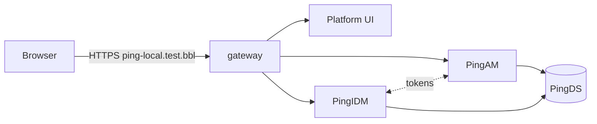

# Ping Identity Platform 8 — on-premise on Kubernetes

A self-managed equivalent of **PingOne Advanced Identity Cloud (P1AIC)**, running on a local
Docker Desktop Kubernetes cluster. Every container image is built from the vendor zips in
[`assets/apps/`](assets/apps/README.md). No prebuilt Ping images are used. Deployment and
platform configuration are fully automated, with no clicks in any admin console.

| Component | Version | Role |
| --- | --- | --- |
| PingDS | 8.1.2 | Directory: AM config, AM sessions (CTS), user identities, IDM repository |
| PingAM | 8.1.1 | Login, SSO, OAuth2/OIDC, journeys (realms `/` and `alpha`) |
| PingIDM | 8.1.2 | Identity management, user self-service REST |
| Platform UI | 8.1.2 | Admin console `/platform`, end-user portal `/enduser`, login UI `/login` |
| Gateway | nginx 1.29 | HTTPS for `https://ping-local.test.bbl`, path routing |



## Quick start

Run these in WSL (Ubuntu) from the project root, after the [one-time setup](docs/setup.md):

```bash
cd /mnt/d/source_code/work/p1aic/on-premise
make preflight     # machine ready?
make build         # build 5 images from the zips (~1 min)
make deploy        # deploy + configure everything (~2-3 min)
make verify        # 17 end-to-end checks
make help          # all targets: setup, status, logs-am, restart-idm, down, reset, lint, ...
```

Every `make` target is a thin wrapper around a script in `src/scripts/`, so
`bash src/scripts/deploy.sh` is the same as `make deploy`.

Then open:

| URL | What | Sign in as |
| --- | --- | --- |
| <https://ping-local.test.bbl/platform> | Platform admin console | `amadmin` / `AM_ADMIN_PASSWORD` from `.env` |
| <https://ping-local.test.bbl/enduser/?realm=alpha> | End-user portal | a user in realm `alpha` |
| <https://ping-local.test.bbl/am/ui-admin/> | AM native admin console | `amadmin` |

IDM 8.1 ships no native admin UI. IDM is managed through the Platform admin console.

> **New PC? Company laptop?** First decide whether Windows should trust the local CA
> (`make trust`, normal browser) or not (`make browser`, a dev browser profile). Step-by-step
> for both, plus the company-laptop fixes (proxy, port 443/80 conflicts):
> [docs/setup-paths.md](docs/setup-paths.md).

## Documentation

| Doc | Read it when you want to… |
| --- | --- |
| [docs/dependencies.md](docs/dependencies.md) | check what you need: host software and versions, zips, images, network, ports |
| [docs/setup.md](docs/setup.md) | prepare a machine (Docker Desktop, Kubernetes, WSL, hosts, certificates) |
| [docs/setup-paths.md](docs/setup-paths.md) | choose **trusted** (normal browser) or **untrusted** (`make browser`) setup, and get through a company laptop |
| [docs/commands.md](docs/commands.md) | look up any `make` command: setup, `.env` (create / show / change / recover), deploy, diagnose, reset |
| [docs/running.md](docs/running.md) | build, deploy, verify, tear down; what each script does |
| [docs/daily-operations.md](docs/daily-operations.md) | start/stop, check status, read logs, find passwords, manage users, apply changes |
| [docs/troubleshooting.md](docs/troubleshooting.md) | fix something that is broken (symptom → cause → fix) |
| [docs/architecture.md](docs/architecture.md) | understand how the pieces fit: network, TLS, data, login flows, design decisions |
| [docs/configuration.md](docs/configuration.md) | look up `.env` settings, secrets, and exactly what the automation configures |

## Repository layout

```text
assets/apps/        vendor zips (not in git — see assets/apps/README.md)
src/docker/         one Dockerfile per image: ds, am, idm, platform-ui, platform-config
src/k8s/            Kubernetes manifest templates (${VAR} filled from .env)
src/config/         platform configuration Job: configure.sh + AM payloads
src/scripts/        everything you run: preflight, build, deploy, verify, teardown, ...
Makefile            short names for the scripts (`make help`)
docs/               documentation
.env                your settings and secrets (git-ignored; created by init-env.sh)
.secrets/           generated certificates (git-ignored)
```

Project rules for contributors (planning, activity log, git) are in [CLAUDE.md](CLAUDE.md).

> **Dev/test only.** This deployment uses one replica of everything, a local CA, generated
> secrets in a file, and the vendor's demo keystores in IDM. See
> [architecture.md → Not production-ready](docs/architecture.md#not-production-ready).
