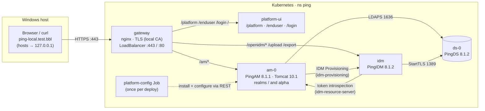
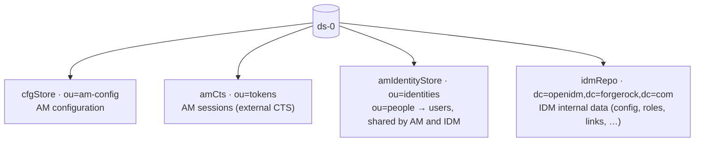
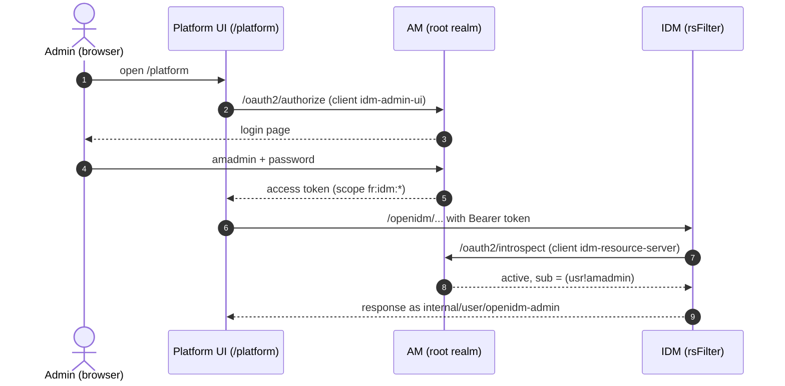
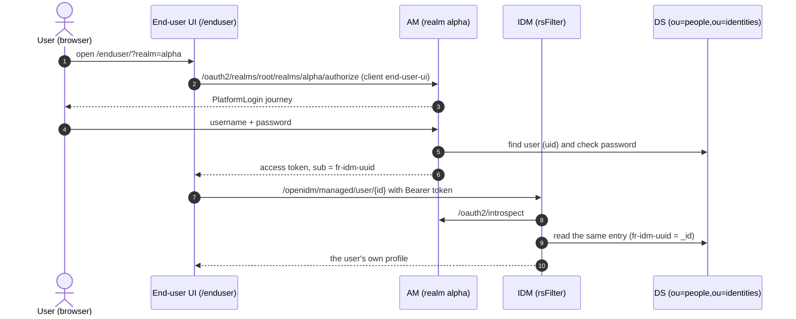
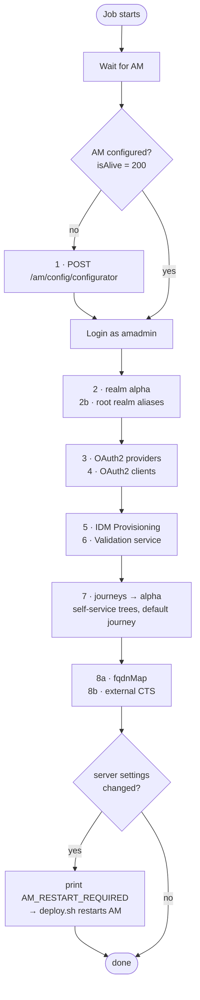
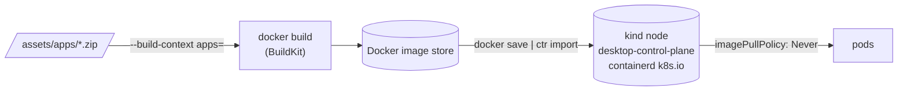

# Architecture

## Overview

All connections to DS use TLS issued from the **DS deployment CA**. The browser-facing
certificate comes from the **local platform CA**.

### Data in DS

One DS server holds four backends:

Everything is served from **one origin**: `https://ping-local.test.bbl`. The UIs, AM and
IDM share that origin, so no CORS configuration is needed. The Ping sample setup uses five
hostnames and needs CORS in AM and IDM.

## Components

| Workload | Kind | Storage | Image |
| --- | --- | --- | --- |
| `ds` | StatefulSet, 1 replica, headless Service | PVC `data-ds-0` 5 Gi | `ping-local/ds:8.1.2` |
| `am` | StatefulSet, 1 replica | PVC `home-am-0` 2 Gi (`/home/forgerock`) | `ping-local/am:8.1.1` |
| `idm` | Deployment, 1 replica (Recreate) | none (data in DS) | `ping-local/idm:8.1.2` |
| `platform-ui` | Deployment | none | `ping-local/platform-ui:8.1.2.0813` |
| `gateway` | Deployment + Service `LoadBalancer` | none | `nginxinc/nginx-unprivileged:1.29-alpine` |
| `platform-config` | Job (re-created every deploy) | none | `ping-local/platform-config:1` |

Every pod runs as non-root with the `RuntimeDefault` seccomp profile. Every container has
`allowPrivilegeEscalation: false` and drops all Linux capabilities. Each workload gets only
the Secret keys it needs: DS gets its own six; the config Job needs nearly all of them.

### DS (directory)

- First boot runs `setup` with the profiles `am-config`, `am-cts`,
  `am-identity-store:8.0.0` and `idm-repo:8.1.0`. Later boots just start DS. The volume
  holds `instance/`, `deployment-id` and a setup marker.
- **All binds require TLS.** DS rejects plain LDAP simple binds even for service accounts.
  Certificates come from a **deployment ID** created once by `ds-deployment-id.sh`. Its CA
  (`.secrets/ds-ca.pem`) is mounted into AM and IDM as Secret `ds-ca`, and they add it to
  their truststores at startup.
- The certificate is issued for `ds-0.ds.<ns>.svc.cluster.local` (`DS_HOST`), so clients
  must use exactly that name.

### AM

- The WAR is exploded to `/am` on Tomcat 10.1 / JDK 21. A `RemoteIpValve` trusts
  `X-Forwarded-Proto/Port` from the gateway, so AM sees `https://ping-local.test.bbl:443`.
- Config and bootstrap files (`openam/`, `.openamcfg/`) are on the PVC, so a restarted
  pod comes back configured.
- **Realms:** `/` (root) is for administration (amadmin, admin clients); **`alpha`** holds
  end users, like P1AIC.
- Sessions are in **external CTS** on DS (`ou=famrecords,ou=openam-session,ou=tokens`), so
  they survive AM restarts.

### IDM

- Its repository is DS. The vendor `repo.ds.json` gets the connection values as
  `&{openidm.repo.*}` properties, filled in from environment variables (`IDM_PROP_*` →
  `boot.properties`).
- Platform changes are applied at **image build time** by
  `src/docker/idm/platform/patch-conf.sh`:
  - `managed/user` is stored in **AM's identity store** (`ou=people,ou=identities`, named
    `fr-idm-uuid=<_id>`, with AM's object classes). This is the *shared identity store*: one
    user entry that both AM and IDM read and write. There is no sync.
  - `authentication.json` becomes an **rsFilter**: IDM accepts only AM OAuth2 tokens,
    which it checks with AM's `/oauth2/introspect`.
  - The `platformSettings` in `ui-configuration.json` let the admin UIs use AM for login.

- IDM 8.1 ships **no native admin UI** (`/admin` returns 404). Administration is done in
  the Platform admin console. The gateway route and the `/admin/*` redirect URIs are
  harmless leftovers from the Ping sample setup.

### Platform UI

- The vendor static bundles are served by one nginx: `/platform` (admin), `/enduser` and
  `/login`. At container start, `variable_replacement.sh` writes the AM/IDM URLs (derived
  from `FQDN`) into the JS files.

### Gateway

- This is an nginx Deployment we own, instead of an ingress controller (upstream
  ingress-nginx is retired). It terminates TLS with the local-CA certificate, routes by
  path, and sets `X-Forwarded-*`. Docker Desktop publishes the `LoadBalancer` Service on
  Windows `localhost:443/80`.

## Login and token flows

**Admin (Platform admin console):**

1. The browser opens `/platform`. The UI redirects to AM `/am/oauth2/authorize`
   (client `idm-admin-ui`, root realm).
2. amadmin signs in at AM. AM issues an access token with scope `fr:idm:*` (implied consent).
3. The UI calls IDM `/openidm/...` with `Authorization: Bearer <token>`.
4. IDM's rsFilter introspects the token at `http://am.ping.svc.cluster.local:8080/am/oauth2/introspect`
   (client `idm-resource-server`). Subject `(usr!amAdmin)` is mapped to `internal/user/openidm-admin`
   with the admin roles.

**End user (realm alpha):**

1. `/enduser/?realm=alpha` → AM `/am/oauth2/realms/root/realms/alpha/authorize`
   (client `end-user-ui`).
2. The user signs in through the **PlatformLogin** journey (alpha's default).
3. IDM introspects the token. The subject `usr` is mapped to `managed/user/`, and since
   AM's user id = `fr-idm-uuid` = IDM `_id`, it's the same entry.

**AM → IDM:** journeys and the IDM Provisioning service call IDM with tokens from client
`idm-provisioning` (client credentials). IDM maps `(age!idm-provisioning)` to the
`platform-provisioning` role.

## Configuration automation

`deploy.sh` runs the `platform-config` Job (`src/config/configure.sh`, idempotent):

| Step | What | Why it's there |
| --- | --- | --- |
| 1 | AM install via `POST /am/config/configurator` (skipped if `isAlive` = 200) | No Amster in the zip |
| 2, 2b | Realm `alpha`; root realm aliases for in-cluster AM host names | AM picks the realm from the host name |
| 3 | OAuth2 provider in root + alpha (scopes, clients may skip consent) | |
| 4 | OAuth2 clients from `src/config/am/clients/*.json`, merged over AM's client template | PUT replaces whole sections |
| 5 | IDM Provisioning service → `http://idm.<ns>.svc…:8080/openidm` | |
| 6 | Validation service: `https://FQDN/*` allowed as goto URL | |
| 7 | Vendor sample journeys (from the AM zip) → alpha; self-service tree mapping; alpha default journey `PlatformLogin` | |
| 8a | `fqdnMap` for in-cluster AM host names | IDM introspection over the service name |
| 8b | External CTS on DS | Sessions survive restarts |

Steps 8a/8b change server-level settings. The Job then prints `AM_RESTART_REQUIRED`
and `deploy.sh` restarts AM. Details: [configuration.md](configuration.md).

## Images and the kind node

Docker Desktop's Kubernetes runs as a hidden kind node container (`desktop-control-plane`)
with its own containerd image store. `build-images.sh` therefore runs
`docker save  | docker exec -i desktop-control-plane ctr -n k8s.io images import -`,
and pods use `imagePullPolicy: Never`. Images are built straight from the zips with
BuildKit named contexts (`--build-context apps=assets/apps`). Nothing is ever extracted
into the repo.

## Design decisions

| Decision | Reason |
| --- | --- |
| Build from vendor zips, not ForgeOps images | Use exactly the downloaded versions; full control |
| Docker Desktop Kubernetes | Local, no registry needed |
| Own nginx gateway, no ingress controller | ingress-nginx was retired upstream (Mar 2026); config stays in the repo |
| Single origin for UI, AM and IDM | No CORS, simpler cookies |
| Local CA, imported into Windows | The browser trusts it; the UI's JavaScript calls to AM/IDM would fail on an untrusted cert |
| TLS everywhere to DS, policy not weakened | DS rejects non-TLS binds; we distribute its CA instead |
| Shared identity store (one DS) | The Ping sample "shared" variant; no sync needed |
| Realm `alpha` for users | Matches P1AIC's layout |
| Config via REST Job, idempotent | No Amster; re-runnable; versioned in `src/config/` |
| One Platform UI pod for three apps | Less memory, one image |
| WSL bash scripts only | One supported shell; Docker + kubectl via Docker Desktop integration |

## Not production-ready

This is a **dev/test** environment:

- Single replica of everything, with no DS replication or backups.
- Secrets live in a local `.env` file. IDM still uses the vendor demo keystore
  (`security/keystore.jceks`).
- The local CA's private key is in `.secrets/`.
- AM's amadmin password and the OAuth2 client secrets are static values from `.env`.
- AM debug, audit and monitoring use defaults. There's no resource tuning beyond memory limits.

For production, look at Ping's ForgeOps reference (DS replication, secret management,
proper PKI) and Ping's platform security guidance.
