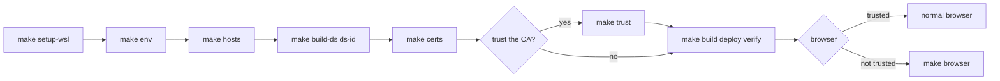
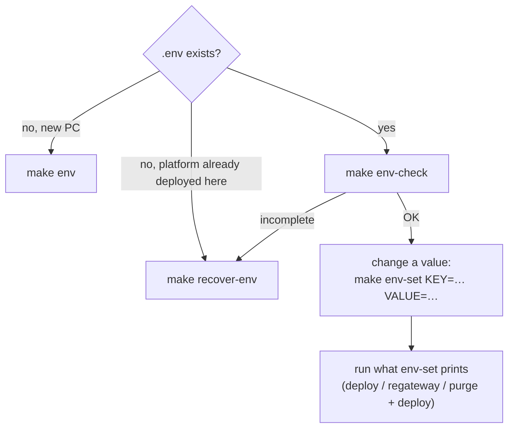

# Command reference

Every command is a `make` target. Run them in **WSL** from the project root:

```bash
cd /mnt/c/.../ping-platform-onprem-k8s
make help            # the same list, grouped, in your terminal
```

Each target is a thin wrapper around a script in `src/scripts/`. Running the script yourself
does the same thing (see [running.md](running.md)).

## The usual order



Which path to take is explained in [setup-paths.md](setup-paths.md).

## One-time setup

| Command | What it does | When |
| --- | --- | --- |
| `make setup` | Runs `setup-wsl env hosts build-ds ds-id certs trust preflight` in order | New PC where `make trust` works (Path A). It stops if trust fails; on Path B run the steps one by one |
| `make setup-wsl` | Installs missing WSL packages and kubectl, links `~/.kube/config` to the Windows kubeconfig, checks the cluster API | Once per WSL distro (asks for your sudo password) |
| `make hosts` | Adds `127.0.0.1 ping-local.test.bbl` to the **Windows** hosts file | Once per PC (UAC prompt) |
| `make ds-id` | Creates the DS deployment ID (saved to `.env`) and exports the DS CA to `.secrets/ds-ca.pem` | Once, after `make build-ds` |
| `make certs` | Creates the local CA and the HTTPS certificate for `FQDN` in `.secrets/` | Once; again after changing `FQDN` |
| `make trust` | Imports the local CA into **your** Windows trusted roots (click Yes) | Path A. Fails clearly if policy blocks it |
| `make trust-machine` | Same, for the **whole PC** (UAC admin prompt) | Path A when `make trust` is blocked and you have admin |
| `make browser` | Opens Edge/Chrome in a separate dev profile that ignores the certificate and uses no proxy | Path B: every time you open the platform |

## Settings and secrets (`.env`)

`.env` holds every setting and password. It's git-ignored, so **back it up**. Never edit it
with `echo … > .env`: a single `>` replaces the whole file. Use `make env-set`.

| Command | What it does | Example |
| --- | --- | --- |
| `make env` | **Creates** `.env` from `.env.example` with random passwords. Does nothing if `.env` exists | `make env` (new PC only) |
| `make env-show` | Shows every setting, with secrets masked (first 3 characters + `***`) | `make env-show` |
| `make env-set` | Changes **one** value: replaces the line (removes duplicates) or adds it, backs up `.env`, tells you what to run next | `make env-set KEY=GATEWAY_HTTP_PORT VALUE=3031` |
| `make env-check` | Checks that `.env` is complete (the same check every script runs) | `make env-check` |
| `make recover-env` | **Rebuilds** a lost or broken `.env` from `.env.example` + the cluster Secret `platform-secrets`, so the passwords match the data | `make recover-env` (other namespace: `make recover-env NS=myns`) |
| `make env-reset` | **New** passwords (backs up the old `.env`). Only for a fresh platform | `make purge` → `make env-reset CONFIRM=yes` → `make ds-id` → `make deploy` |



What `make env-set` tells you to run next:

| Key | Next step |
| --- | --- |
| `GATEWAY_HTTP_PORT` | `make regateway` |
| `*_MEMORY`, `*_VERSION`, `STORAGE_CLASS` | `make deploy` |
| `ADMIN_CLIENT_ID`, `ENDUSER_CLIENT_ID` | Don't change these on their own: they must match the AM client files in `src/config/am/clients/`. Change both together, then `make config` |
| `IDM_RS_CLIENT_SECRET`, `IDM_PROVISIONING_CLIENT_SECRET` | `make deploy && make restart-idm` |
| `FQDN`, `COOKIE_DOMAIN`, `NAMESPACE`, `DS_*`, `AM_*`, `IDM_ADMIN_PASSWORD` | Baked into existing data, so `make purge && make deploy` (deletes data). For `FQDN` also `make certs hosts` |

All keys are explained in [configuration.md](configuration.md).

## Build, deploy, verify

| Command | What it does | Example |
| --- | --- | --- |
| `make preflight` | Checks tools, Docker RAM, cluster, zips, hosts entry, proxy, prerequisites | first thing on a new PC |
| `make build` | Builds all 5 images from the zips and loads them into the cluster (about 1 min) | after `git pull` with Dockerfile changes |
| `make build-<x>` | Builds one image: `build-ds`, `build-am`, `build-idm`, `build-ui`, `build-config` | `make build-idm && make restart-idm` |
| `make deploy` | Deploys and configures everything. Idempotent; keeps data (about 2–3 min first time, about 15 s after) | after any change |
| `make verify` | Connectivity diagnosis, then 17 end-to-end checks (login, tokens, users) | after deploy, any time |
| `make up` | `build` + `deploy` + `verify` | — |

## Network, gateway, diagnosis

| Command | What it does | When |
| --- | --- | --- |
| `make check-gateway` | Proxy → DNS → port 443 → TLS → Windows browser path; names who owns port 443/80 and how to free it | the browser shows 404/503/504, or `verify` shows `000` |
| `make regateway` | Recreates the gateway LoadBalancer Service so Docker Desktop publishes it (clears a stuck finalizer) | after freeing port 443/80, or after `env-set GATEWAY_HTTP_PORT` |
| `make diag` | Support bundle: pods, events, endpoints, logs, in-cluster checks → `.rendered/diag-*.txt` (no secrets) | when asking for help |

## Daily use

| Command | What it does | Example |
| --- | --- | --- |
| `make status` | Pods, services, volumes | `make status` |
| `make urls` | Prints the platform URLs | `make urls` |
| `make logs-<x>` | Logs of one component (`ds am idm ui gateway config`); `TAIL=` lines | `make logs-am TAIL=200` |
| `make restart-<x>` | Rolling restart of one component (`ds am idm ui gateway`) | `make restart-idm` |
| `make config` | Rebuilds and re-runs the platform configuration Job (after editing `src/config/`) | `make config` |

## Stop and reset

| Command | What it does | Data |
| --- | --- | --- |
| `make down` | Removes the workloads (frees RAM) | **kept**; `make deploy` brings everything back |
| `make purge` | Deletes the namespace (asks first) | **deleted** |
| `make reset` | `purge` → fresh `deploy` → `verify` | **deleted** |

## Development

| Command | What it does |
| --- | --- |
| `make lint` | shellcheck + hadolint (must print `lint: clean`) |
| `make docs-check` | Renders every Mermaid diagram in README/docs; fails on syntax errors |
| `make log MSG="…"` | Adds an entry to the hourly activity log (`logs/activity/`) |
| `make plan TITLE="…"` | Creates a plan file in `progress/plan/` |
| `make help` | Lists everything above |
