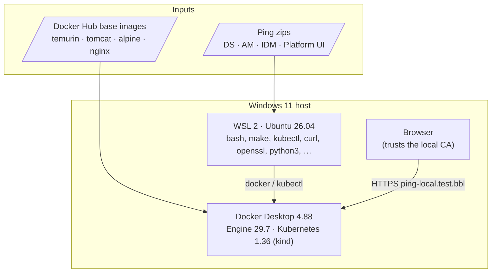
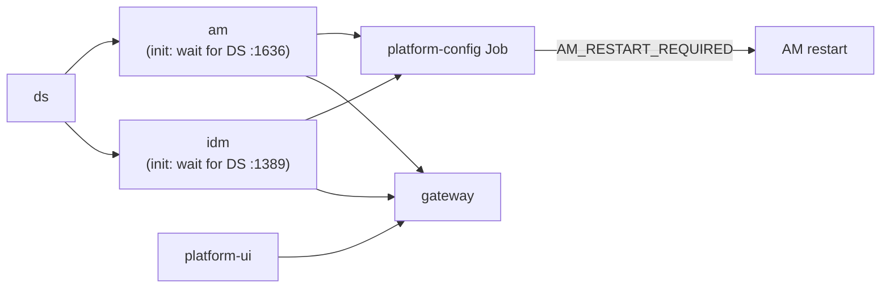

# Dependencies

Everything this project needs to build and run. **Tested** versions are the ones this
setup was verified with on 2026-11-11. Other versions may work but haven't been tried.

## Overview

## 1. Host machine

| What | Tested | Required | Why |
| --- | --- | --- | --- |
| OS | Windows 11 Pro 10.0.26300 | Windows 10/11 with WSL 2 | Docker Desktop + WSL |
| CPU | 20 logical cores | 4+ | build + 5 JVM/nginx pods |
| RAM for Docker | 11.6 GiB | **≥ 10 GiB** (preflight warns below) | DS 2 Gi, AM 2.5 Gi, IDM 2 Gi + headroom |
| Disk | — | **~15 GB** free | images ~4.2 GB (AM 1.78, IDM 1.47, DS 0.65, UI 0.27 GB), stored twice (Docker + kind node), plus build cache + volumes (7 Gi PVCs) |
| Free ports on localhost | — | **443** and **80** | gateway LoadBalancer (HTTPS + HTTP→HTTPS redirect) |
| Admin rights | — | once | hosts-file entry (UAC prompt) |

## 2. Host software

| Software | Tested version | Install / check | Used for |
| --- | --- | --- | --- |
| Docker Desktop | **4.88.1** (Engine 29.7.2, buildx 0.36.1) | docker.com · `docker version` | images, Kubernetes |
| Docker Desktop Kubernetes | **v1.36.1**, kind provisioner, containerd 2.3.1 | Settings → Kubernetes | runs the platform |
| WSL | **3.0.5.0** | `wsl --version` | shell for all scripts |
| Ubuntu (WSL distro) | **26.04 LTS** | Microsoft Store / `wsl --install` | — |
| Docker Desktop WSL integration | on for the distro | Settings → Resources → WSL integration | `docker` + `kubectl` inside WSL |
| Browser | any current | — | Platform UIs |

### Inside WSL

`make setup-wsl` (or `bash src/scripts/setup-wsl.sh`) installs whatever is missing.

| Tool | Tested version | Package | Used by |
| --- | --- | --- | --- |
| bash | 5.3.9 | (base) | all scripts |
| GNU make | 4.4.1 | `make` | `Makefile` |
| kubectl | v1.36.1 | Docker integration, else downloaded from dl.k8s.io | deploy, teardown, verify, preflight |
| curl | 8.18.0 | `curl` | verify, setup-wsl |
| openssl | 3.5.5 | `openssl` | tls.sh, init-env.sh, verify.sh |
| perl | 5.40.1 | `perl` | `render()` templating in lib.sh |
| python3 | 3.14.4 | `python3` | verify.sh (JSON parsing) |
| envsubst | gettext 0.23.2 | `gettext-base` | — (installed for completeness) |
| unzip | 6.00 | `unzip` | — (installed for completeness) |
| git | 2.53.0 | `git` | version control |

Also on the Windows side: `powershell.exe`, used by `add-hosts-entry.sh`, `tls.sh --trust`
and `setup-wsl.sh` (built into Windows). Git Bash is optional and is used for the
`lint` / `docs-check` image pulls if WSL's Docker credential helper fails.

## 3. Ping software (vendor zips)

Download from <https://backstage.pingidentity.com/> (needs a Ping account) into
`assets/apps/`. The names are configured in `.env`.

| File | Product | Runs on | Notes |
| --- | --- | --- | --- |
| `DS-8.1.2.zip` | PingDS 8.1.2 | **Java 25** | fails on Java 21 |
| `AM-8.1.1.zip` | PingAM 8.1.1 (`AM-8.1.1.war`) | Java 17+ bytecode → JDK 21, Tomcat 10.1 | needs Jakarta EE (Servlet 5+); also supplies the sample journeys (`sample-trees-8.1.1.zip`) |
| `IDM-8.1.2.zip` | PingIDM 8.1.2 | Java 21 | vendor `Custom.Dockerfile` uses Java 21 |
| `PlatformUI-8.1.2.0813.zip` | Ping Platform UI 8.1.2 | nginx (static files) | |

## 4. Container images (pulled from Docker Hub)

| Image | Used for | Where |
| --- | --- | --- |
| `alpine:3.22` | unpacking zips at build time; base of `platform-config` | all Dockerfiles |
| `eclipse-temurin:25-jre` | DS runtime | `src/docker/ds/Dockerfile` |
| `tomcat:10.1-jdk21-temurin` | AM runtime | `src/docker/am/Dockerfile` |
| `eclipse-temurin:21-jre` | IDM runtime | `src/docker/idm/Dockerfile` |
| `nginxinc/nginx-unprivileged:1.29-alpine` | Platform UI base **and** the gateway (pulled by the cluster) | `src/docker/platform-ui/Dockerfile`, `src/k8s/60-gateway.yaml` |
| `koalaman/shellcheck:v0.10.0` | `make lint` (optional) | Makefile |
| `hadolint/hadolint:v2.12.0-alpine` | `make lint` (optional) | Makefile |
| `minlag/mermaid-cli:11.4.2` | `make docs-check` (optional) | Makefile |

Packages added inside the images: `tini` (DS, AM, IDM), `curl` (AM, IDM, config),
`fonts-dejavu` (IDM, needed by the workflow engine), `bash jq gettext` (config) and
`jq` (IDM build stage only).

The base-image tags are not pinned to digests, so a rebuild can pick up a newer patch
release (see [architecture.md → Not production-ready](architecture.md#not-production-ready)).

## 5. Network access

| Destination | When | Why |
| --- | --- | --- |
| `registry-1.docker.io` (Docker Hub) | first build; first deploy | base images; the gateway image is pulled by the cluster |
| `dl.k8s.io` | `setup-wsl.sh`, only if kubectl is missing | kubectl binary + checksum |
| Ubuntu apt mirrors | `setup-wsl.sh`, only if packages are missing | WSL packages |
| `backstage.pingidentity.com` | manually, once | vendor zips |

At runtime the platform needs **no** internet access. Everything is served locally on
`https://ping-local.test.bbl` (hosts → 127.0.0.1).

## 6. Runtime dependencies between components

`deploy.sh` applies them in this order and waits for each to be ready. AM and IDM also
wait for DS in an init container, so a restart in any order recovers by itself.

| Component | Needs at runtime |
| --- | --- |
| DS | its volume; Secret keys `DS_*`, `AM_*_ADMIN_PASSWORD` (first boot only) |
| AM | DS (LDAPS, trusts `ds-ca`); its volume (`/home/forgerock`) |
| IDM | DS (StartTLS, trusts `ds-ca`); AM for token introspection |
| Platform UI | nothing (static); the browser talks to AM/IDM through the gateway |
| Gateway | Secret `gateway-tls`; Services `am`, `idm`, `platform-ui` |
| platform-config Job | AM reachable; Secret `platform-secrets` |

## 7. Generated files you must keep

| File | Created by | Losing it means |
| --- | --- | --- |
| `.env` | `make env` | passwords for existing data gone → `make reset` with new `.env` |
| `.secrets/ds-ca.pem` + `DS_DEPLOYMENT_ID` | `make ds-id` | AM/IDM can't trust DS → re-export (same ID) or reset |
| `.secrets/platform-ca.*`, `gateway.*` | `make certs` | browser trust breaks → `make certs trust deploy` |
