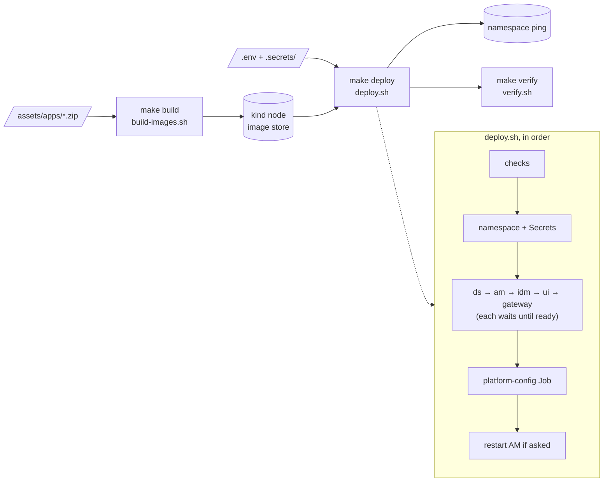

# Build, deploy, verify, tear down

Run everything in **WSL** from the project root:
`cd /mnt/d/source_code/work/p1aic/on-premise`. Complete [setup.md](setup.md) first.

## The normal sequence

```bash
bash src/scripts/build-images.sh   # 1. images from zips → loaded into the cluster
bash src/scripts/deploy.sh         # 2. Kubernetes objects + platform configuration
bash src/scripts/verify.sh         # 3. end-to-end test
```

Every step is safe to re-run.



The same steps are available as `make` targets (`make help`). `make up` runs build,
deploy and verify.

## 1. `build-images.sh` — build the images

```bash
bash src/scripts/build-images.sh               # all: ds am idm ui config
bash src/scripts/build-images.sh am idm        # only some
bash src/scripts/build-images.sh --no-load ds  # build only, don't copy into the cluster
```

| Image | Built from | Notes |
| --- | --- | --- |
| `ping-local/ds:8.1.2` | `DS-8.1.2.zip` | Java 25; on first boot, sets itself up with the AM + IDM profiles |
| `ping-local/am:8.1.1` | `AM-8.1.1.zip` (the `.war`) | Tomcat 10.1 + JDK 21, served under `/am` |
| `ping-local/idm:8.1.2` | `IDM-8.1.2.zip` | Java 21; config patched for the platform at build time |
| `ping-local/platform-ui:8.1.2.0813` | `PlatformUI-…zip` | nginx serving `/platform`, `/enduser`, `/login` |
| `ping-local/platform-config:1` | `src/config/` + journeys from the AM zip | runs the configuration Job |

Each image is copied into Docker Desktop's Kubernetes node after it's built (`docker save |
ctr import`). Pods use `imagePullPolicy: Never`. Cached rebuilds take a few seconds; a
first build takes about 1–2 minutes.

## 2. `deploy.sh` — deploy and configure

```bash
bash src/scripts/deploy.sh
```

What it does, in order:

1. **Checks:** the cluster is reachable, all 5 images are in the node, the DS deployment
   ID and CA exist, and the gateway certificate exists.
2. **Namespace + Secrets** (`platform-secrets`, `ds-ca`, `gateway-tls`), created from
   `.env` and `.secrets/`. Secrets are never written to disk as YAML.
3. **Workloads**, applied one at a time; each must be ready before the next starts:
   `ds` → `am` → `idm` → `platform-ui` → `gateway`.
4. **`platform-config` Job:** installs AM (first run only) and configures the platform
   (realm `alpha`, OAuth2, journeys, IDM link, sessions in DS, …). The full log is copied
   to `.rendered/platform-config.log`.
5. **AM restart**, if the Job printed `AM_RESTART_REQUIRED` (server-level settings changed).

Typical timings on a fresh cluster: DS 20 s, AM 22 s, IDM 21 s, UI 10 s, gateway 1 s,
config Job 36 s, AM restart 20 s, for about **2 min 10 s** in total. A re-deploy with no
changes takes about **15 s**. It re-runs the config Job and restarts nothing, except the
gateway if its manifest or certificate changed.

Rendered manifests (with your values filled in) are written to `.rendered/k8s/`
(git-ignored). That's useful for checking what was applied.

## 3. `verify.sh` — end-to-end test

```bash
bash src/scripts/verify.sh          # creates and then deletes a test user
bash src/scripts/verify.sh --keep   # keep the test user and print its password
```

It first checks **connectivity**: proxy → DNS → TCP 443 → TLS → the same request from
Windows. If the gateway can't be reached, it stops there with the cause and the fix
(`make check-gateway` runs only this part). Then it runs 17 checks through
`https://ping-local.test.bbl`, the same way a browser would:

1. **Health:** `/platform`, `/enduser`, `/login`, `/am/isAlive.jsp`, IDM `info/ping`.
2. **amadmin:** AM login → OAuth2 token for `idm-admin-ui` → IDM accepts it as `openidm-admin`.
3. **Shared identities:** a user created in IDM appears in DS under
   `ou=people,ou=identities` and in AM realm `alpha`.
4. **End user:** that user logs in through the `PlatformLogin` journey → gets an
   `end-user-ui` token → IDM maps it to the user's own profile.
5. **Cleanup:** the test user is deleted.

The exit code is the number of failures. If anything fails, see [troubleshooting.md](troubleshooting.md).

## 4. `teardown.sh` — remove

```bash
bash src/scripts/teardown.sh               # remove workloads, KEEP data (PVCs)
bash src/scripts/teardown.sh --purge       # delete the namespace incl. all data (asks to confirm)
bash src/scripts/teardown.sh --purge --yes # same, without the question
```

After a plain teardown, `deploy.sh` brings everything back with the same data and AM
config. After `--purge`, `deploy.sh` starts from scratch: a fresh DS, AM installed again,
and all users gone.

## Other scripts

| Script | Purpose |
| --- | --- |
| `preflight.sh` | Is the machine ready? (tools, RAM, cluster, zips, hosts entry, proxy variables) |
| `make diag` (`diag.sh`) | Support bundle: pods, events, endpoints, logs, in-cluster checks from the gateway pod, connectivity → `.rendered/diag-*.txt` (no secrets; safe to share) |
| `make check-gateway` | Why can't I reach `https://ping-local.test.bbl`? Proxy → DNS → TCP 443 → TLS → Windows browser path (proxy setting, CA trust, who answers) |
| `setup-wsl.sh` | One-time WSL setup |
| `init-env.sh [--force]` | Create `.env` with random secrets |
| `ds-deployment-id.sh [--force]` | Create the DS deployment ID and export the DS CA |
| `tls.sh [--renew] [--trust]` | HTTPS certificate for `FQDN`; trust the CA in Windows |
| `add-hosts-entry.sh [fqdn]` | Add the Windows hosts entry (UAC prompt) |

All scripts write a line to the project activity log (`logs/activity/`, git-ignored). It
keeps one file per hour.

## Lint

The repo is kept clean under **shellcheck** and **hadolint**. Their configs are
`.shellcheckrc` and `.hadolint.yaml`, and each ignored rule is explained there. Run them
from Git Bash: pulling these images from WSL can fail on Docker Desktop's credential
helper.

```bash
export MSYS_NO_PATHCONV=1
docker run --rm -v "$(pwd -W)":/mnt:ro -w /mnt koalaman/shellcheck:v0.10.0 -x \
  src/scripts/*.sh src/config/configure.sh src/docker/*/entrypoint.sh src/docker/idm/platform/patch-conf.sh
for f in src/docker/*/Dockerfile; do
  docker run --rm -i -v "$(pwd -W)/.hadolint.yaml":/cfg.yaml:ro hadolint/hadolint:v2.12.0-alpine hadolint --config /cfg.yaml - < "$f"
done
```

Both must print nothing.
