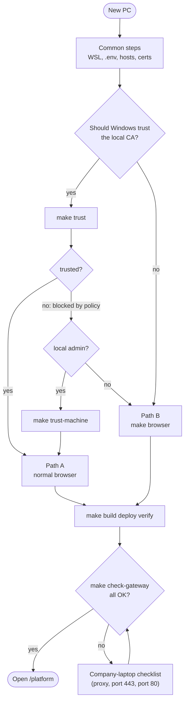

# Setting up a PC: trusted vs. untrusted certificate

The platform's HTTPS certificate for `https://ping-local.test.bbl` is signed by a **local CA**
that this project creates (`.secrets/platform-ca.pem`). Before you start on a PC, decide
whether Windows should trust that CA:

| | **Path A: trust the CA** | **Path B: don't trust the CA** |
| --- | --- | --- |
| When | Your own PC, or anywhere `make trust` works | Company laptop where policy blocks it, or you don't want to change Windows trust |
| Browser | Your normal browser, no warnings | `make browser`: a separate Edge/Chrome dev profile |
| What you see | Padlock, clean | "Not secure" + a yellow "unsupported command-line flag" banner (expected) |
| Changes to Windows | CA added to your Trusted Root store | None |

Both paths run the **same platform**. Only the browser side differs. All commands run in
**WSL** from the project root (see [setup.md](setup.md) for Docker Desktop, WSL and the zips).



## Common steps (both paths)

Run these once per PC:

```bash
cd /mnt/c/.../ping-platform-onprem-k8s        # your clone of the repo
make setup-wsl       # WSL packages, kubectl, kubeconfig (asks for sudo)
make env             # .env with random passwords — NEW PC only (see "Already deployed" below)
make hosts           # 127.0.0.1 ping-local.test.bbl in the Windows hosts file (UAC prompt)
make build-ds ds-id  # DS image + DS deployment ID/CA
make certs           # local CA + HTTPS certificate
make preflight       # every line OK
```

> **Already deployed on this PC but `.env` is lost or broken?** Don't run `make env`, because
> that creates *new* passwords that don't match the data. Run `make recover-env` instead.
> To change one value in `.env`, edit the line (`sed -i 's/^KEY=.*/KEY=value/' .env`). Never
> `echo 'KEY=value' > .env`: a single `>` replaces the whole file (`>>` appends).

## Path A: trust the CA (normal browser)

```bash
make trust           # click "Yes" in the Windows security dialog
make build deploy    # ~1 min + ~2-3 min
make verify          # all OK
```

Then **restart the browser** and open <https://ping-local.test.bbl/platform>. Sign in as
`amadmin` with the password from `AM_ADMIN_PASSWORD` in `.env`.

- `make trust` must end with **"CA trusted by Windows"**. If it says Windows didn't accept the
  CA (company policy), try `make trust-machine` (needs local admin). If that's blocked too,
  use **Path B**.
- `make check-gateway` shows **"Windows trusts the local CA"** when Path A is complete.

## Path B: don't trust the CA (`make browser`)

```bash
make build deploy    # no `make trust`
make check-gateway   # fix anything red with the checklist below, except the CA-trust line
make browser         # opens https://ping-local.test.bbl/platform/ in the dev profile
```

- `make browser` starts Edge (or Chrome) with its **own profile**
  (`%LOCALAPPDATA%\ping-local-dev-browser`), `--ignore-certificate-errors` and
  `--no-proxy-server`. Your normal browser and its settings aren't touched. Run
  `make browser` every time you want to use the platform; bookmarks inside that profile
  persist.
- **Expected on Path B:** "Not secure" in the address bar, the yellow
  "unsupported command-line flag" banner, and in `make check-gateway` / `make verify` the
  line **"Windows does NOT trust the local CA"**. `make verify` still ends with
  `verify passed`.
- Use that browser window **only** for this platform: it accepts any certificate.
- `make setup` includes `make trust` and stops if trust fails. On Path B, run the common
  steps one by one as listed above.

## Company-laptop checklist

Every item below was hit on a real company laptop. `make check-gateway` names the failing
one, and `make diag` writes a full report (no secrets).

| `make check-gateway` / symptom | Cause | Fix |
| --- | --- | --- |
| `verify` shows `000` everywhere; browser shows **404** | Company **proxy** (HTTPS_PROXY / Windows proxy) gets `ping-local.test.bbl` | Scripts bypass it already. Path B: `make browser` uses no proxy. Path A: add `ping-local.test.bbl` to the Windows proxy bypass list |
| `gateway LoadBalancer … <pending>` + `k8s Service ingress-nginx/ingress-nginx-controller`; browser shows **503** (nginx) | An older ingress (for example an old ForgeOps install) owns **port 443** | `kubectl -n ingress-nginx patch svc ingress-nginx-controller -p '{"spec":{"type":"ClusterIP"}}'`, then `make regateway`. Undo: same command with `LoadBalancer` (only one of them can have 443) |
| `<pending>` + `Windows :::80 pid 4 System` | Windows HTTP.sys owns **port 80** | `sed -i 's/^GATEWAY_HTTP_PORT=.*/GATEWAY_HTTP_PORT=3031/' .env` (add the line if it's missing), then `make regateway` |
| `<pending>` + `…:8081 pid … macmnsvc` | The McAfee agent owns 8081 | Pick another free port for `GATEWAY_HTTP_PORT` (3031 worked) |
| `kindccm-…` container on 443 | Docker Desktop's proxy for another LoadBalancer | Goes away with that Service; don't stop it by hand |
| `NAMESPACE: unbound variable` / ".env incomplete" | `.env` overwritten or deleted | `make recover-env` |
| `make regateway` hangs | Docker Desktop's LB cleanup didn't respond | `make regateway` clears the stuck finalizer by itself after about 10 s |

`GATEWAY_HTTP_PORT` only changes the plain-HTTP redirect port. You always open
`https://ping-local.test.bbl/...` without a port number.

## Daily use

| | Path A | Path B |
| --- | --- | --- |
| Start | Docker Desktop running → `make status` | same |
| Open the platform | normal browser → `https://ping-local.test.bbl/platform` | `make browser` |
| Check health | `make verify` | `make verify` (CA-trust line FAIL is expected) |
| Something wrong | `make check-gateway`, `make diag` | same |

More in [daily-operations.md](daily-operations.md) and [troubleshooting.md](troubleshooting.md).

## Switching paths later

- **B → A** (for example IT later allows the CA): `make trust` or `make trust-machine`, restart
  the browser, then use the normal browser.
- **A → B:** remove the CA from Windows (`certmgr.msc` → Trusted Root Certification
  Authorities → Certificates → "ping-local dev CA (…)"), then use `make browser`.
- The platform itself doesn't change. No redeploy is needed for either switch.
